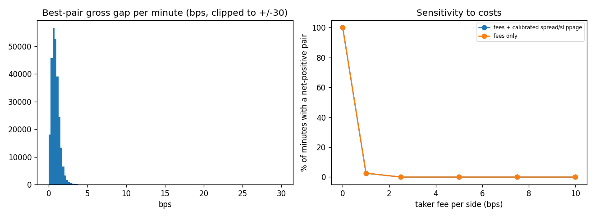

# 1-minute candle analysis: cross-exchange price gaps

_Generated 2026-10-14T14:04:34.349488+00:00_

> **Limited, assumption-based simulation.** Candles contain no bid/ask and no depth. The numbers
> below show how large close-to-close gaps between exchanges were, and how sensitive any
> 'profit' is to cost assumptions. They are NOT achievable profit and NOT evidence about
> latency effects (project_plan.md §8.5).

## Data

- Exchanges: binance, bybit, okx; 1-minute candles; period 2026-04-14T10:03:00+00:00 -> 2026-10-14T10:02:00+00:00
- Minutes present on all exchanges (inner join, nothing filled): 263,520
- Price used: candle close (last trade). It lies on either side of the spread, so gaps include bid/ask bounce noise.

## Gap statistics per ordered pair (buy -> sell), in basis points

| pair | median_gross_bps | std_bps | p01_bps | p99_bps | max_bps | pct_minutes_gross_positive |
|---|---|---|---|---|---|---|
| binance->bybit | -0.04885 | 0.7111 | -1.7 | 1.668 | 32.69 | 46.93 |
| binance->okx | 0.1324 | 0.7705 | -1.7 | 1.924 | 56.57 | 57.26 |
| bybit->binance | 0.04885 | 0.7111 | -1.667 | 1.7 | 8.691 | 52.85 |
| bybit->okx | 0.1854 | 0.7304 | -1.641 | 1.905 | 23.8 | 60.38 |
| okx->binance | -0.1324 | 0.7704 | -1.924 | 1.7 | 5.392 | 42.44 |
| okx->bybit | -0.1854 | 0.7304 | -1.905 | 1.641 | 9.349 | 38.76 |

A persistent non-zero median gap is a structural offset (for example quote-currency or venue premium), not by itself an opportunity: exploiting it needs inventory transfers that are not modeled.

## Calibrated one-side execution costs (from recorded order books at 10,000 notional)

```json
{
  "binance": {
    "buy_cost_bps": 0.0005993253870961723,
    "sell_cost_bps": 0.0005993211493748873,
    "half_spread_bps": 0.0005992651935637495,
    "samples": 752
  },
  "bybit": {
    "buy_cost_bps": 0.0059925345019529175,
    "sell_cost_bps": 0.005992656598730051,
    "half_spread_bps": 0.005992390861560123,
    "samples": 773
  },
  "okx": {
    "buy_cost_bps": 0.005993339002863252,
    "sell_cost_bps": 0.005993705410878292,
    "half_spread_bps": 0.005992821797527053,
    "samples": 755
  }
}
```

## Sensitivity: minutes where the best pair has net gap > 0

Net gap = gross gap - 2 x fee per side - (assumed spread/slippage). `episodes` merges consecutive profitable minutes; `upper_bound_pnl_per_10k` counts every profitable minute as a trade at 10,000 and ignores persistence, inventory, latency and fills, so it is an upper bound.

| fee_bps_per_side | cost_assumption | minutes | profitable_minutes | pct_profitable | episodes | mean_episode_minutes | mean_net_bps_when_profitable | upper_bound_pnl_per_10k |
|---|---|---|---|---|---|---|---|---|
| 0 | fees only | 263520 | 263511 | 100 | 10 | 2.635e+04 | 0.871 | 2.295e+05 |
| 0 | fees + calibrated spread/slippage | 263520 | 263487 | 99.99 | 34 | 7750 | 0.8627 | 2.273e+05 |
| 1 | fees only | 263520 | 6902 | 2.619 | 4456 | 1.549 | 0.4677 | 3228 |
| 1 | fees + calibrated spread/slippage | 263520 | 6766 | 2.568 | 4370 | 1.548 | 0.4684 | 3169 |
| 2.5 | fees only | 263520 | 48 | 0.01821 | 34 | 1.412 | 2.383 | 114.4 |
| 2.5 | fees + calibrated spread/slippage | 263520 | 47 | 0.01784 | 33 | 1.424 | 2.425 | 114 |
| 5 | fees only | 263520 | 3 | 0.001138 | 3 | 1 | 17.49 | 52.46 |
| 5 | fees + calibrated spread/slippage | 263520 | 3 | 0.001138 | 3 | 1 | 17.48 | 52.44 |
| 7.5 | fees only | 263520 | 2 | 0.000759 | 2 | 1 | 20.82 | 41.64 |
| 7.5 | fees + calibrated spread/slippage | 263520 | 2 | 0.000759 | 2 | 1 | 20.81 | 41.62 |
| 10 | fees only | 263520 | 1 | 0.0003795 | 1 | 1 | 36.57 | 36.57 |
| 10 | fees + calibrated spread/slippage | 263520 | 1 | 0.0003795 | 1 | 1 | 36.56 | 36.56 |



## Month by month (fee 5.0 bps per side + calibrated costs)

| month | profitable_minutes | minutes | pct_profitable |
|---|---|---|---|
| 2026-04 | 0 | 23877 | 0 |
| 2026-05 | 0 | 44640 | 0 |
| 2026-06 | 1 | 43200 | 0.002315 |
| 2026-07 | 1 | 44640 | 0.00224 |
| 2026-08 | 1 | 44640 | 0.00224 |
| 2026-09 | 0 | 43200 | 0 |
| 2026-10 | 0 | 19323 | 0 |

## Limitations

- No bid/ask, no depth: spreads and slippage are assumed from a 15-minute sample, not observed over the period.
- One-minute resolution cannot show how long a gap lasted or whether it survived a delay.
- Fee rates are assumptions; real tiers differ by account.
- Cross-exchange USDT pricing differences are treated as price gaps; transfer, rebalancing and withdrawal costs are ignored.
- Only BTC/USDT was analysed.
