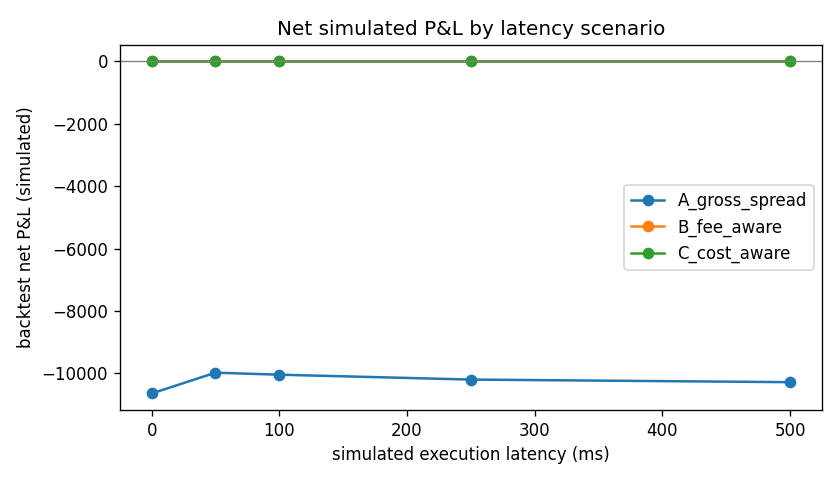
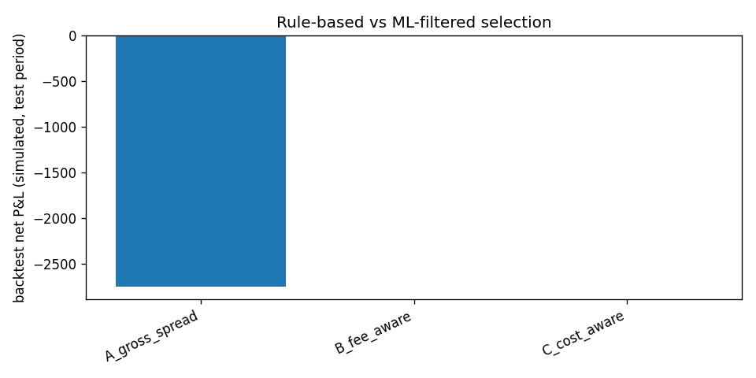

# Experiment report: BTC/USDT

_Generated 2026-10-13T13:59:24.012066+00:00_

> Recorded public order-book snapshots; simulation only, no orders were placed.


## Setup (plan §19.4)

- **Dataset period:** 2026-10-13T13:30:01.434060+00:00 -> 2026-10-13T13:45:01.398224+00:00
- **Data source / resolution:** `data\raw\real_sample`; 773 ticks; median tick spacing 1014 ms; REST depth snapshots
- **Records loaded:** 2318 (0 invalid, 0 malformed); by exchange {'binance': 772, 'bybit': 773, 'okx': 773}
- **Baselines:** A gross spread, B fee-aware, C cost-aware (+ D ML-filtered)
- **Models:** logistic_regression, random_forest, gradient_boosting; chronological 60/20/20 split with purge; threshold and hyper-parameters chosen on validation only
- **Feature set:** gross_spread_bps, net_edge_bps, fees_bps, latency_cost_bps, top_qty_ratio, configured_latency_ms, buy_exchange, sell_exchange, data_age_ms, event_skew_ms, slippage_bps, depth_ratio, imbalance_buy, imbalance_sell, mid_change_buy_bps, mid_change_sell_bps, spread_change_bps
- **Target:** label = 1 if replayed execution net profit > 0 after fees (see `dataset.py`)
- **Fees / costs:** taker fee 0.1000% per exchange (assumption); modeled latency cost 0.0 bps in baseline C; notional 10,000
- **Latency scenarios (ms):** [0, 50, 100, 250, 500]; **staleness limits:** quantiles [0.5, 0.75, 0.9]
- **Backtest:** pre-positioned inventory (1,000,000 quote and 11.979 base per exchange), cooldown 2 ticks, 1 trade per tick, full fills at visible depth, no transfer fees

## Experiment 1: gross spread versus net profit

| latency_ms | priced_candidates | gross_positive | gross_positive_net_profitable | pct_gross_positive_unprofitable_after_costs | mean_gross_spread_bps_of_gross_positive | mean_net_outcome_per_gross_positive |
|---|---|---|---|---|---|---|
| 0 | 4558 | 2231 | 0 | 1 | 0.8289 | -19.23 |
| 50 | 4242 | 2075 | 0 | 1 | 0.8224 | -19.18 |
| 100 | 4308 | 2108 | 0 | 1 | 0.823 | -19.18 |
| 250 | 4360 | 2133 | 0 | 1 | 0.8224 | -19.17 |
| 500 | 4362 | 2133 | 0 | 1 | 0.821 | -19.17 |

## Experiment 2: market-data staleness

Data age = decision time minus the oldest book receive time of the pair (cross-exchange receive skew). Limits are derived from observed quantiles, not universal thresholds.

| max_data_age_ms | selector | rejected_stale | candidates | selected | trades | backtest_net_pnl |
|---|---|---|---|---|---|---|
|  | A_gross_spread | 0 | 4558 | 2231 | 554 | -1.064e+04 |
|  | C_cost_aware | 0 | 4558 | 0 | 0 | 0 |
| 123.2 | A_gross_spread | 2316 | 2279 | 1109 | 351 | -6768 |
| 123.2 | C_cost_aware | 2316 | 2279 | 0 | 0 | 0 |
| 459.2 | A_gross_spread | 1166 | 3418 | 1670 | 429 | -8263 |
| 459.2 | C_cost_aware | 1166 | 3418 | 0 | 0 | 0 |
| 1068 | A_gross_spread | 464 | 4104 | 2007 | 509 | -9800 |
| 1068 | C_cost_aware | 464 | 4104 | 0 | 0 | 0 |

## Experiment 3: simulated execution latency

Resolution limit: with median tick spacing of 1014 ms, any latency between 1 ms and one tick maps to the next snapshot, so nearby scenarios can coincide. These are simulation settings, not measured exchange latencies.

| latency_ms | selector | selected | trades | backtest_net_pnl | pct_profitable_trades | max_drawdown |
|---|---|---|---|---|---|---|
| 0 | A_gross_spread | 2231 | 554 | -1.064e+04 | 0 | 1.064e+04 |
| 0 | B_fee_aware | 0 | 0 | 0 |  | 0 |
| 0 | C_cost_aware | 0 | 0 | 0 |  | 0 |
| 50 | A_gross_spread | 2075 | 508 | -9976 | 0 | 9976 |
| 50 | B_fee_aware | 0 | 0 | 0 |  | 0 |
| 50 | C_cost_aware | 0 | 0 | 0 |  | 0 |
| 100 | A_gross_spread | 2108 | 511 | -1.004e+04 | 0 | 1.004e+04 |
| 100 | B_fee_aware | 0 | 0 | 0 |  | 0 |
| 100 | C_cost_aware | 0 | 0 | 0 |  | 0 |
| 250 | A_gross_spread | 2133 | 519 | -1.02e+04 | 0 | 1.02e+04 |
| 250 | B_fee_aware | 0 | 0 | 0 |  | 0 |
| 250 | C_cost_aware | 0 | 0 | 0 |  | 0 |
| 500 | A_gross_spread | 2133 | 523 | -1.028e+04 | 0 | 1.028e+04 |
| 500 | B_fee_aware | 0 | 0 | 0 |  | 0 |
| 500 | C_cost_aware | 0 | 0 | 0 |  | 0 |



## Experiment 4: rule-based versus ML filtering (latency 250 ms, test period)

```json
{
  "split": {
    "validation_start": "2026-10-13T13:39:19.087541+00:00",
    "test_start": "2026-10-13T13:42:09.204000+00:00"
  },
  "purged": {
    "train": 6,
    "validation": 6
  },
  "rows": {
    "train": 2600,
    "validation": 882,
    "test": 866
  },
  "ml_skipped": "only 0 positive training labels (< 30)"
}
```

| selector | candidates | selected | precision | recall | pr_auc | trades | backtest_net_pnl | pct_profitable_trades |
|---|---|---|---|---|---|---|---|---|
| A_gross_spread | 866 | 420 | 0 | None | None | 141 | -2753 | 0 |
| B_fee_aware | 866 | 0 |  | None | None | 0 | 0 |  |
| C_cost_aware | 866 | 0 |  | None | None | 0 | 0 |  |



## Experiment 5: feature ablation

skipped: only 0 positive training labels (< 30)

## Experiment 6: cross-period (walk-forward) evaluation

| fold | test_rows | test_positives | C_cost_aware_pnl | ml_logistic_regression_pnl | ml_gradient_boosting_pnl | note |
|---|---|---|---|---|---|---|
| 1 | 1096 | 0 | 0 | None | None | only 0 positive training labels (< 30) |
| 2 | 1100 | 0 | 0 | None | None | only 0 positive training labels (< 30) |
| 3 | 1088 | 0 | 0 | None | None | only 0 positive training labels (< 30) |

## Known limitations

- Labels and fills come from replaying recorded snapshots; they are approximations, not real executions.
- Pre-positioned inventory is assumed; cross-exchange transfers, rebalancing and withdrawal fees are not modeled.
- Fee rates are assumptions, not verified for any account.
- At latency 0 the label equals the decision-time net edge (the trade executes on the same snapshot), so rule C and the models look perfect by construction; only latency > 0 tests prediction.
- A single test period (or a few walk-forward folds) cannot establish generalization.
- ML is not assumed to beat the cost-aware rule; where it does not, that is reported as is.
- Novelty claims require the literature review in `docs/literature_review.md` (not yet done).
