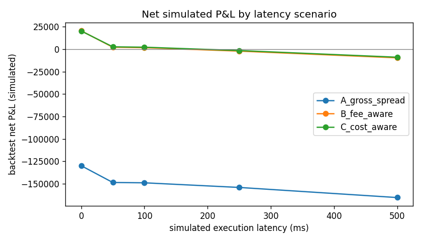
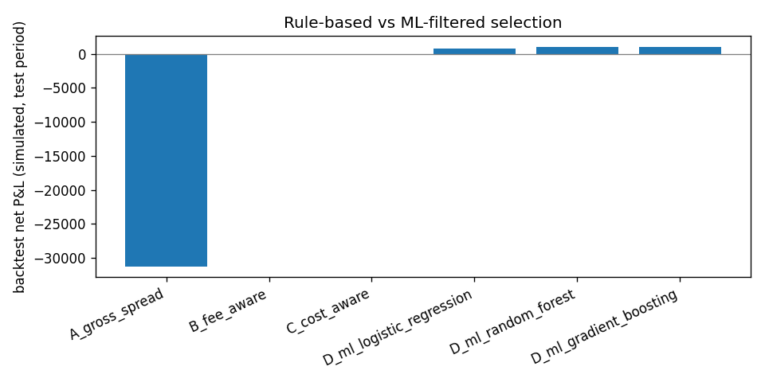

# Experiment report: BTC/USDT

_Generated 2026-10-13T14:19:01.649547+00:00_

> **SYNTHETIC DATA.** These numbers come from a generator with assumed jumps and exchange lags. They show that the pipeline works and what the assumptions imply; they are NOT findings about real markets.


## Setup (plan §19.4)

- **Dataset period:** 2026-01-01T00:00:00.166588+00:00 -> 2026-01-01T00:50:00.302448+00:00
- **Data source / resolution:** `data\raw\synthetic`; 12000 ticks; median tick spacing 244 ms; REST depth snapshots
- **Records loaded:** 36000 (0 invalid, 0 malformed); by exchange {'binance': 12000, 'bybit': 12000, 'okx': 12000}
- **Baselines:** A gross spread, B fee-aware, C cost-aware (+ D ML-filtered)
- **Models:** logistic_regression, random_forest, gradient_boosting; chronological 60/20/20 split with purge; threshold and hyper-parameters chosen on validation only
- **Feature set:** gross_spread_bps, net_edge_bps, fees_bps, latency_cost_bps, top_qty_ratio, configured_latency_ms, buy_exchange, sell_exchange, data_age_ms, event_skew_ms, slippage_bps, depth_ratio, imbalance_buy, imbalance_sell, mid_change_buy_bps, mid_change_sell_bps, spread_change_bps
- **Target:** label = 1 if replayed execution net profit > 0 after fees (see `dataset.py`)
- **Fees / costs:** taker fee 0.1000% per exchange (assumption); modeled latency cost 0.0 bps in baseline C; notional 10,000
- **Latency scenarios (ms):** [0, 50, 100, 250, 500]; **staleness limits:** quantiles [0.5, 0.75, 0.9]
- **Backtest:** pre-positioned inventory (1,000,000 quote and 15.369 base per exchange), cooldown 2 ticks, 1 trade per tick, full fills at visible depth, no transfer fees

## Experiment 1: gross spread versus net profit

| latency_ms | priced_candidates | gross_positive | gross_positive_net_profitable | pct_gross_positive_unprofitable_after_costs | mean_gross_spread_bps_of_gross_positive | mean_net_outcome_per_gross_positive |
|---|---|---|---|---|---|---|
| 0 | 71934 | 26870 | 1092 | 0.9594 | 6.489 | -16.07 |
| 50 | 71928 | 26867 | 689 | 0.9744 | 6.489 | -18.11 |
| 100 | 71928 | 26867 | 682 | 0.9746 | 6.489 | -18.14 |
| 250 | 71928 | 26867 | 633 | 0.9764 | 6.489 | -18.53 |
| 500 | 71916 | 26863 | 483 | 0.982 | 6.49 | -19.42 |

## Experiment 2: market-data staleness

Data age = decision time minus the oldest book receive time of the pair (cross-exchange receive skew). Limits are derived from observed quantiles, not universal thresholds.

| max_data_age_ms | selector | rejected_stale | candidates | selected | trades | backtest_net_pnl |
|---|---|---|---|---|---|---|
|  | A_gross_spread | 0 | 71934 | 26870 | 8376 | -1.298e+05 |
|  | C_cost_aware | 0 | 71934 | 1092 | 505 | 2.035e+04 |
| 135 | A_gross_spread | 35990 | 35968 | 13434 | 5580 | -8.438e+04 |
| 135 | C_cost_aware | 35990 | 35968 | 583 | 325 | 1.319e+04 |
| 216 | A_gross_spread | 17990 | 53952 | 20139 | 7067 | -1.074e+05 |
| 216 | C_cost_aware | 17990 | 53952 | 848 | 424 | 1.695e+04 |
| 309 | A_gross_spread | 7200 | 64741 | 24158 | 7841 | -1.201e+05 |
| 309 | C_cost_aware | 7200 | 64741 | 1002 | 483 | 1.936e+04 |

## Experiment 3: simulated execution latency

Resolution limit: with median tick spacing of 244 ms, any latency between 1 ms and one tick maps to the next snapshot, so nearby scenarios can coincide. These are simulation settings, not measured exchange latencies.

| latency_ms | selector | selected | trades | backtest_net_pnl | pct_profitable_trades | max_drawdown |
|---|---|---|---|---|---|---|
| 0 | A_gross_spread | 26870 | 8376 | -1.298e+05 | 0.05396 | 1.298e+05 |
| 0 | B_fee_aware | 1147 | 524 | 2.051e+04 | 0.9676 | 4.132 |
| 0 | C_cost_aware | 1092 | 505 | 2.035e+04 | 1 | 0 |
| 50 | A_gross_spread | 26867 | 8360 | -1.485e+05 | 0.03086 | 1.485e+05 |
| 50 | B_fee_aware | 1147 | 523 | 2227 | 0.4455 | 538.4 |
| 50 | C_cost_aware | 1092 | 504 | 2687 | 0.4643 | 564.5 |
| 100 | A_gross_spread | 26867 | 8362 | -1.488e+05 | 0.0305 | 1.488e+05 |
| 100 | B_fee_aware | 1147 | 524 | 1740 | 0.4294 | 721.5 |
| 100 | C_cost_aware | 1092 | 505 | 2276 | 0.4495 | 747.6 |
| 250 | A_gross_spread | 26867 | 8362 | -1.54e+05 | 0.02691 | 1.54e+05 |
| 250 | B_fee_aware | 1147 | 524 | -2096 | 0.313 | 2496 |
| 250 | C_cost_aware | 1092 | 505 | -1454 | 0.3307 | 1877 |
| 500 | A_gross_spread | 26863 | 8352 | -1.653e+05 | 0.01808 | 1.653e+05 |
| 500 | B_fee_aware | 1147 | 524 | -9571 | 0.1145 | 9648 |
| 500 | C_cost_aware | 1092 | 505 | -8888 | 0.1208 | 8994 |



## Experiment 4: rule-based versus ML filtering (latency 250 ms, test period)

```json
{
  "split": {
    "validation_start": "2026-01-01T00:30:00.069333+00:00",
    "test_start": "2026-01-01T00:40:00.032545+00:00"
  },
  "purged": {
    "train": 12,
    "validation": 6
  },
  "rows": {
    "train": 43148,
    "validation": 14376,
    "test": 14386
  },
  "model_versions": {
    "logistic_regression": "logistic_regression-e93ef4b8-s42",
    "random_forest": "random_forest-e93ef4b8-s42",
    "gradient_boosting": "gradient_boosting-e93ef4b8-s42"
  },
  "thresholds": {
    "logistic_regression": 0.9,
    "random_forest": 0.9,
    "gradient_boosting": 0.35
  }
}
```

| selector | candidates | selected | precision | recall | pr_auc | trades | backtest_net_pnl | pct_profitable_trades |
|---|---|---|---|---|---|---|---|---|
| A_gross_spread | 14386 | 5197 | 0.02752 | 0.6471 | 0.1048 | 1704 | -3.125e+04 | 0.02465 |
| B_fee_aware | 14386 | 210 | 0.2905 | 0.276 | 0.1048 | 92 | -68.95 | 0.3804 |
| C_cost_aware | 14386 | 201 | 0.2736 | 0.2489 | 0.1049 | 91 | -73.79 | 0.3736 |
| D_ml_logistic_regression | 14386 | 90 | 0.3222 | 0.1312 | 0.1049 | 40 | 807.6 | 0.525 |
| D_ml_random_forest | 14386 | 81 | 0.4444 | 0.1629 | 0.1777 | 38 | 987.1 | 0.7105 |
| D_ml_gradient_boosting | 14386 | 51 | 0.5686 | 0.1312 | 0.1751 | 28 | 1054 | 0.8571 |



## Experiment 5: feature ablation

| model | variant | selected | precision | recall | pr_auc | backtest_net_pnl |
|---|---|---|---|---|---|---|
| logistic_regression | all_features | 90 | 0.3222 | 0.1312 | 0.1049 | 807.6 |
| logistic_regression | without_data_age | 87 | 0.3218 | 0.1267 | 0.1066 | 775.3 |
| logistic_regression | without_depth | 87 | 0.3333 | 0.1312 | 0.1071 | 807.6 |
| logistic_regression | without_movement | 57 | 0.2982 | 0.07692 | 0.1069 | 603.7 |
| gradient_boosting | all_features | 51 | 0.5686 | 0.1312 | 0.1751 | 1054 |
| gradient_boosting | without_data_age | 52 | 0.5192 | 0.1222 | 0.1586 | 904.2 |
| gradient_boosting | without_depth | 46 | 0.6087 | 0.1267 | 0.1782 | 984 |
| gradient_boosting | without_movement | 49 | 0.4694 | 0.1041 | 0.1536 | 605.1 |

## Experiment 6: cross-period (walk-forward) evaluation

| fold | test_rows | test_positives | C_cost_aware_pnl | ml_logistic_regression_pnl | ml_gradient_boosting_pnl | note |
|---|---|---|---|---|---|---|
| 1 | 17990 | 241 | 361.1 | 856.7 | 1446 |  |
| 2 | 17988 | 279 | -605.5 | 545.3 | 971.2 |  |
| 3 | 17978 | 311 | -89.24 | 1065 | 1131 |  |

## Known limitations

- Labels and fills come from replaying recorded snapshots; they are approximations, not real executions.
- Pre-positioned inventory is assumed; cross-exchange transfers, rebalancing and withdrawal fees are not modeled.
- Fee rates are assumptions, not verified for any account.
- At latency 0 the label equals the decision-time net edge (the trade executes on the same snapshot), so rule C and the models look perfect by construction; only latency > 0 tests prediction.
- A single test period (or a few walk-forward folds) cannot establish generalization.
- ML is not assumed to beat the cost-aware rule; where it does not, that is reported as is.
- Novelty claims require the literature review in `docs/literature_review.md` (not yet done).
